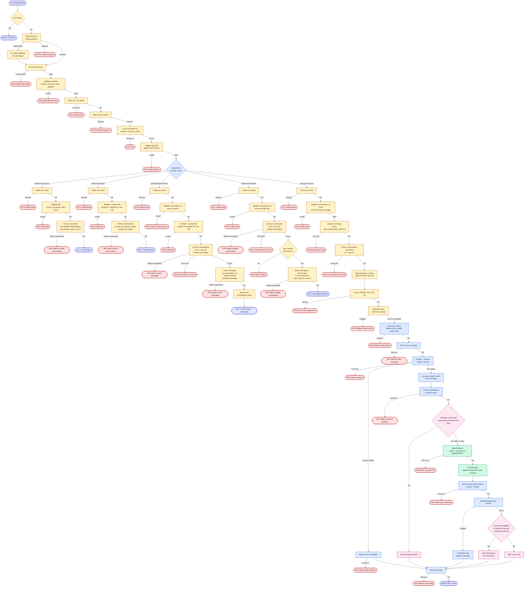

# Machine Learning expert chatbot application 2.0

Improved version of **[V1](https://github.com/KushagraKumarSinha/Chatbot_Architecture_V1)**:
1) Implemented Router and Registry pattern
2) Added structured logging
3) Added better error handling and retry logic
4) Created evaluation set
5) Accounted for prompt injection
6) Implemented response streaming

Improvements to this:
1) Adding proxy before request hits backend
2) Improving security in the frontend

## Flowchart

## Learn More

For info about the concepts used in this project, refer to:

- **[API notes](https://github.com/KushagraKumarSinha/API_notes_and_examples)**
- **[Backend concept notes](https://github.com/KushagraKumarSinha/Backend_Concept_Notes)**
- **[AI agent notes](https://github.com/KushagraKumarSinha/AI_Agent_Notes)**

